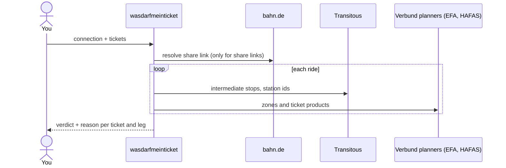

# wasdarfmeinticket

Paste a DB connection, list the tickets you hold, and get told per leg
whether each ticket covers it: `valid`, `partial`, `invalid` or `unknown`,
with a reason. For a zone ticket that ends mid-ride it names the last stop
it is valid to.

It comes as a command line tool, an HTTP API and a browser app.

## How it works



- **bahn.de** only resolves share links.
- **[Transitous](https://transitous.org)** (open timetable data) supplies the
  stops of each ride.
- **Verbund planners** say which zones a ride needs and which tickets are
  sold for it. The tool compares that with your ticket and models no tariff
  rules itself.

A ride that cannot be matched between the sources is `unknown`, never `valid`.

## Usage

```sh
mage build   # or: go build -o bin/wasdarfmeinticket ./cmd/wasdarfmeinticket
mage test    # offline tests

bin/wasdarfmeinticket check -tickets tickets.json 'https://www.bahn.de/buchung/start?vbid=<id>'
bin/wasdarfmeinticket check -tickets tickets.json -from Rottenburg -to Konstanz -departure 2026-11-23T10:45

bin/wasdarfmeinticket serve -addr :8080
curl -s localhost:8080/v1/check -d '{
  "link": "https://www.bahn.de/buchung/start?vbid=<id>",
  "tickets": [{"type": "deutschlandticket"}, {"type": "verbund", "from": "Tübingen Hbf", "to": "Reutlingen Hbf"}]
}'
```

Docker: `docker build -t wasdarfmeinticket . && docker run --rm -p 8080:8080 -v wasdarfmeinticket-cache:/cache wasdarfmeinticket`.

Output is Markdown on the CLI (`-format json` for JSON) and JSON over HTTP
(`Accept: text/markdown` or `?format=markdown` for Markdown, `?progress=1`
to stream progress ahead of it).

### The connection

- **Connection link** from the bahn.de address bar (`…/fahrplan/suche#…&gh=…`):
  most reliable, needs no request to bahn.de.
- **Share link** (`…/buchung/start?vbid=<id>`), also embedded in other text.
- **Search link** (`…/fahrplan/suche#so=…&zo=…&hd=…`): the first connection
  at or after that time is taken.
- **`from`, `to`, `departure`** (German local time).
- **`recon`**: if bahn.de blocks the share-link lookup, open
  `https://www.bahn.de/web/api/angebote/verbindung/<vbid>` in a browser and
  pass what it shows (CLI: `-recon <file>` or `-recon -`).

### Tickets

- `{"type": "deutschlandticket"}`
- `{"type": "laenderticket", "name": "..."}`: `baden-wuerttemberg-ticket`,
  `bayern-ticket`, `brandenburg-berlin-ticket`, `hessenticket`,
  `mecklenburg-vorpommern-ticket`, `niedersachsen-ticket`, `24hticket-nrw`,
  `rheinland-pfalz-saarland-ticket`, `saarland-ticket`, `sachsen-ticket`,
  `sachsen-anhalt-ticket`, `thueringen-ticket`, `schleswig-holstein-ticket`,
  `quer-durchs-land-ticket`. Most are valid Mon–Fri from 9:00; Hessen,
  Niedersachsen and NRW all day. Valid where a planner sells the ticket for
  the ride, otherwise by rule in local trains whose stops all lie in the
  ticket's states (read from the station ids). Buses, trams and border
  extensions are `unknown` unless a planner confirms them.
- `{"type": "verbund", ...}`, a Verbund ticket, described by
  - route: `"from": "Tübingen Hbf", "to": "Reutlingen Hbf"`, or `"link": "..."`
  - zones: `"net": "naldo", "zones": ["11", "220"]`
  - whole Verbund: `"net": "naldo"`

  `net` is one of `naldo`, `vhb`, `fds`, `vvs`, `kvv`, `vrn`, `ding`, `vgn`,
  `mvv`, `avv`, `vvo`, `vrr`, `vrs`, `westfalentarif`, `gvh`, `vrb`, `rmv`,
  `nvv`, `vbb`, `sh-tarif`, `vmt`, `vbn`, `vsn`, `vvw`, `saarvv`, `mdv`,
  `marego`.
  `POST /v1/tickets/resolve` turns a route ticket into net and zones, so you
  can store it.

### Response

- `results`: per ticket a `verdict` and per leg `verdict` and `reason`;
  `partial` legs carry `validFrom` and `validTo`.
- `coverage`: all tickets together, per leg the stretches and which tickets
  cover them. A stretch without tickets needs another ticket.
- `journey` and `tariff`: the resolved connection and the planner answers.

HTTP status: `400` bad input, `404` link unknown to bahn.de, `503` bahn.de
blocks this client, `502` other upstream failure.

### Cache

Answers are cached for up to 30 days in `wasdarfmeinticket/cache.json` in the
user cache directory. `WASDARFMEINTICKET_CACHE` sets another path, or `off`.

## Coverage

| Planner | Verbünde with zone data | In the browser app |
| --- | --- | --- |
| EFA-BW | naldo, VHB, VGF (`fds`), VVS, VRN, DING | yes |
| KVV | KVV | yes |
| Bahnland Bayern | VGN, AVV | no |
| MVV | MVV | no |
| VVO | VVO | yes |
| VRR | VRR, VRS (Rheinlandtarif) | no |
| Westfalenfahrplan | Westfalentarif | yes |
| efa.de | GVH, VRB | no |
| HAFAS: RMV, NVV, VBB, VMT, VSN, VVW, saarVV | whole network only | no |
| HAFAS: NAH.SH (SH-Tarif), VBN | whole network only | yes |
| HAFAS: NASA | MDV, marego | yes |

Most HAFAS planners sell Verbund fares but name no zones in a usable form
(NASA does). A ride counts as inside such a Verbund when the planner sells
that Verbund's fare for it, so whole-network tickets are checked; zone
tickets there are `unknown`. A ride with no Verbund fare counts as outside
only for VBB and RMV, where this was verified; elsewhere it is `unknown`.
IC/EC trains are left to the EFA planners. The HAFAS settings are the
operators' own app credentials as published in transport-apis.

Not covered: Hamburg (HVV's HAFAS server no longer resolves), the Chemnitz
and Zwickau area, the Altmark, and the Verbünde of northern
Rhineland-Palatinate and of Mecklenburg-Vorpommern outside Rostock.
A ticket of such a Verbund is `unknown`. In local trains the
Deutschlandticket and the Ländertickets work by rule everywhere.

Rules and planners are data: `internal/check/tickets.json`,
`internal/tariff/efa/planners.json` and `internal/tariff/hafas/providers.json`
(HAFAS client settings from
[transport-apis](https://github.com/public-transport/transport-apis)).

## Limits

- Long-distance trains are `invalid`, except an IC that a planner also lists
  as a regional train (for example IC 389 = RE 87). An IC no planner knows is
  `unknown`.
- Night variants (Bayern-Ticket Nacht, …), the weekday variants of the
  MV-Ticket, extensions like "+ Westharz" and regional day tickets are not
  offered.
- Border stretches abroad, public holidays, time limits of Verbund tickets
  and first class are not checked.
- Partial validity is only worked out for zone tickets, from the first or to
  the last stop of a ride.
- Some planners (seen with naldo) name only the zones at both ends of a ride;
  list every zone of a hand-typed ticket.
- bahn.de may block the share-link lookup (`403 OPS_BLOCKED`). Connection
  links, search links and `from`/`to` keep working.
  `WASDARFMEINTICKET_IPV4_ONLY=1` forces IPv4 if only one address family is
  blocked.
- Transitous is volunteer-run; keep the load low. Its User-Agent can be set
  with `WASDARFMEINTICKET_TRANSITOUS_USER_AGENT`.

## Browser app

`web/` is an installable web app: a Svelte page plus this Go code compiled
to WebAssembly. The check runs on the device and calls the services directly,
so only planners that allow cross-origin requests work (see the table).
bahn.de does not, so a share link needs its answer pasted in (the app links
to it).

```sh
cd web
bun install --frozen-lockfile
bun run dev    # engine + app with live reload
bun run test
bun run build  # into web/dist
```

`.github/workflows/app.yml` deploys every push to the main branch to the
branch `dist/app` for GitHub Pages ("Deploy from a branch", `dist/app`, `/`).

## License

[MIT](LICENSE): use, change and share it freely, keeping the copyright notice.
