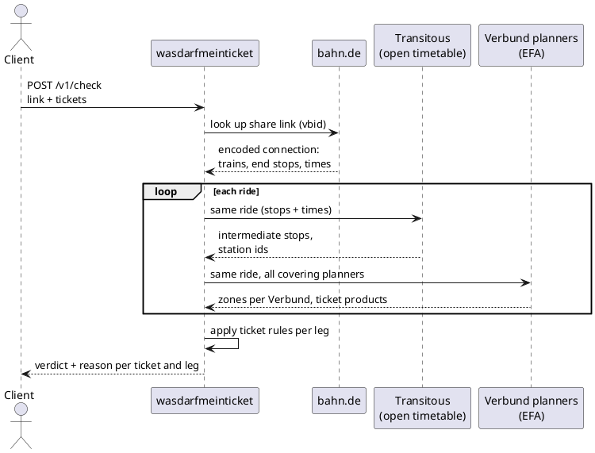

# wasdarfmeinticket

Paste a DB connection link, list the tickets you hold, and get told per leg
whether each ticket covers it: `valid`, `partial`, `invalid` or `unknown`, with
a reason. For a Verbund zone ticket that ends mid-ride it names the stop up to
which the ticket is valid.

There is no frontend yet. This is the core and a JSON API.

## How it works



Three sources, each for what it is good at:

- **bahn.de** only resolves the pasted link. The answer carries the
  connection as an encoded string, which is decoded locally. bahn.de's
  connection search and detail calls are not used.
- **[Transitous](https://transitous.org)**, a community-run service on open
  timetable data (for Germany the DELFI feed, CC-BY-4.0), supplies the
  intermediate stops of each ride and the routes of tickets described by
  `from`/`to`. It has no fares.
- **The Verbund journey planners** compute which zones a ride needs and which
  tickets are sold for it. Zone and border rules are not modelled here; the
  tool compares the planner's answer with your ticket.

A ride is matched between the sources by its planned departure and arrival
times and, where available, the train number. If it cannot be matched, the
answer is `unknown`, never `valid`.

## Usage

```sh
mage build   # or: go build -o bin/wasdarfmeinticket ./cmd/wasdarfmeinticket
mage test    # vet + unit tests, offline (recorded responses)
```

Command line:

```sh
bin/wasdarfmeinticket check -tickets tickets.json \
  'https://www.bahn.de/buchung/start?vbid=<id>'
```

HTTP API:

```sh
bin/wasdarfmeinticket serve -addr :8080

curl -s localhost:8080/v1/check -d '{
  "link": "https://www.bahn.de/buchung/start?vbid=<id>",
  "tickets": [
    {"type": "deutschlandticket"},
    {"type": "verbund", "from": "Tübingen Hbf", "to": "Reutlingen Hbf"}
  ]
}'
```

### Docker

The image holds nothing but the binary and the CA certificates, about
11 MB. `--build-arg COMPRESS=1` packs the binary with UPX and brings the
image to about 5 MB, at the price of a slower start.

```sh
docker build -t wasdarfmeinticket .
docker run --rm -p 8080:8080 -v wasdarfmeinticket-cache:/cache wasdarfmeinticket
```

It starts the HTTP API on port 8080 as an unprivileged user and keeps the
[cache](#cache) in `/cache`.

### Output format

The check result comes as JSON or as a short German Markdown text for
terminals and agents. The text starts with the answer for all tickets
together: the connection leg by leg, which ticket covers which stretch, and
a list of stretches still without a ticket. Details per ticket follow.

- CLI: Markdown by default, `-format json` for JSON.
- HTTP: JSON by default. Send `Accept: text/markdown` (or `text/plain`), or
  add `?format=markdown`, to get `Content-Type: text/markdown`. Errors then
  come as a plain `Fehler: ...` line with the same status codes.

```sh
curl -s -H 'Accept: text/markdown' localhost:8080/v1/check -d '{...}'
```

### Progress

A check takes a while, because several services are asked in turn. What is
being done is reported as it happens:

- CLI: on standard error, with elapsed seconds; `-quiet` turns it off.
- Server: every request's steps go to the server's log.
- HTTP client: add `?progress=1` to a Markdown request to get the steps
  streamed ahead of the result (use `curl -N` to see them live). The status
  is then always `200`; a failure appears as a `Fehler: ...` line.

### Naming the connection

Five ways:

- **Connection link**: the address bahn.de shows in the browser while a
  connection is open (`.../buchung/fahrplan/suche#...&gh=...`). It carries
  exactly that connection, and no request to bahn.de is needed. This is
  the most reliable input.
- **Share link** of one connection (`.../buchung/start?vbid=<id>`). The link
  may be embedded in other text, as the DB Navigator shares it. This is the
  only case that needs a request to bahn.de.
- **Search link** from the bahn.de website
  (`.../buchung/fahrplan/suche#so=...&zo=...&hd=...`). It carries start,
  destination and time itself. A search is not one connection, so the first
  connection departing at or after that time is taken, and the answer says
  so. Searches by arrival time are not supported. A whole city as start
  or destination (bahn.de writes it in capitals, "MÜNCHEN") is taken as
  that city's main station. The connection found
  can differ from the one bahn.de shows first: Transitous combines several
  timetable feeds and, for example, does not accept a 4-minute change at
  Konstanz between a German and a Swiss train.
- **Pasted lookup answer** (`recon`), for when bahn.de refuses the tool's
  share-link lookup but you want exactly the connection of a share link:
  open `https://www.bahn.de/web/api/angebote/verbindung/<vbid>` in a browser
  and pass what it shows as `"recon"` (the whole JSON, or only its
  `hinfahrtRecon` value). On the command line: `-recon <file>`, or
  `-recon -` to read it from standard input.
- **`from`, `to`, `departure`** instead of `link`, for example
  `{"from": "Rottenburg", "to": "Konstanz", "departure": "2026-11-23T10:45"}`
  (German local time). On the command line: `-from`, `-to`, `-departure`.

### Cache

Answers are cached, in memory and in a file, so the same route at another
time of day needs almost no further requests: which zones a line needs
between two stops does not depend on the time.

- Planner answers per line and stop pair, and the zones of route tickets:
  7 days. Resolved share links and stop names: 30 days. The stop list of
  one particular ride: 1 day.
- File: `wasdarfmeinticket/cache.json` in the user cache directory. Set
  `WASDARFMEINTICKET_CACHE` to another path, or to `off` to keep the cache
  in memory only. Delete the file to start fresh, for example after a
  tariff change.

### Tickets

- `{"type": "deutschlandticket"}`: local transport in Germany.
- `{"type": "laenderticket", "name": "..."}`: valid Mon–Fri from 9:00 and all
  day on weekends. Names: `baden-wuerttemberg-ticket`, `bayern-ticket`,
  `quer-durchs-land-ticket`.
- `{"type": "verbund", ...}`: a Verbund zone ticket, described in one of
  these ways:
  - by route: `"from": "Tübingen Hbf", "to": "Reutlingen Hbf"`
  - by a DB share link of the route it was bought for: `"link": "https://..."`
  - by zones: `"net": "naldo", "zones": ["11", "220"]`
  - whole Verbund: `"net": "naldo"` (same as adding `"network": true`)

For a ticket described by route the tool looks up the Verbund and the zones
of every stop along that route and returns them in the result, so you can
see what it assumed. `POST /v1/tickets/resolve` with such a ticket returns
the resolved ticket only; store that to skip the lookup on later checks.

`net` is the Verbund: `naldo`, `vhb`, `fds`, `vgn`, `mvv`. If a route touches
several Verbünde, add `net` to pick one.

### Response

- `journey`: the resolved connection.
- `tariff`: per leg, what the planners returned (zones, products, which planner).
- `verdict` and `coverage`: all tickets taken together. `coverage` has one
  entry per leg with `spans`: consecutive stretches (`from`, `to`) and the
  `tickets` valid on each, as indexes into `results`. A span without tickets
  is a gap that needs a further ticket.
- `results`: per ticket an overall `verdict` and one entry per leg with
  `verdict` and `reason`. Verdicts: `valid`, `partial`, `invalid`, `unknown`,
  and `not_required` for walks.
- A `partial` leg carries `validFrom` and `validTo`, the stops between which
  the ticket is valid. The overall verdict is `partial` when the ticket covers
  some legs or parts of legs, but not the whole journey.

When a zone ticket does not cover a whole ride, the tool asks the planners
about the ride between intermediate stops to find where the ticket stops (or
starts) being valid. This costs a few extra planner queries per such leg, so
those checks take longer.

HTTP status: `400` bad link or ticket, `404` link unknown to bahn.de, `503`
bahn.de is blocking this client, `502` other upstream failure.

## Coverage and limits

| Planner | Area | Verbünde with verified zone data |
| --- | --- | --- |
| EFA-BW | Baden-Württemberg | naldo, VHB, VGF (`fds`) |
| Bahnland Bayern | Bavaria | VGN |
| MVV | Munich region | MVV |

- A zone ticket for a Verbund not listed above yields `unknown`, not `invalid`.
- Long-distance trains are `invalid`, with one exception: an IC that a
  planner also lists as a regional train (same stops, same departure and
  arrival time, for example IC 389 = RE 87 on the Gäubahn) is treated as
  that regional train. An IC no planner could look at yields `unknown`.
- bahn.de has no official API for this. The tool only uses its share-link
  lookup. bahn.de's bot protection may refuse it (`403 OPS_BLOCKED`, seen
  on 2026-11-21 for this tool's client while a browser was still served).
  The tool repeats a refused lookup twice with a pause and then answers
  with a clear error. Search links and `from`/`to`/`departure` do not need
  bahn.de and keep working.
- For a stop outside Germany the Deutschlandticket and the nationwide rule
  of the Quer-durchs-Land-Ticket yield `unknown`: border stretches are not
  modelled.
- If lookups are refused on one machine but not another, compare
  `curl -4` and `curl -6` against bahn.de there. Setting
  `WASDARFMEINTICKET_IPV4_ONLY=1` makes the tool use IPv4 for all upstreams.
- Transitous is a volunteer-run service. Its usage policy asks API users to
  be open source, non-commercial and light on its resources, and to send a
  User-Agent with application name, version and contact. The default is set
  in `internal/timetable/transitous`; override it with
  `WASDARFMEINTICKET_TRANSITOUS_USER_AGENT`.
- Without an answer from Transitous a check still works, but cannot tell how
  far a zone ticket is valid within a ride.
- Public holidays are treated as normal weekdays for the 9:00 rule.
- Time restrictions of Verbund tickets (for example 9-Uhr-Monatskarte) and
  first class are not checked.
- Partial validity is only worked out for Verbund zone tickets, and only
  from the first or to the last stop of a ride.
- A route ticket uses the first local connection Transitous finds on a
  weekday morning. If your ticket is for a different path, describe it by link.
- A route that crosses a Verbund border becomes a ticket for the part inside
  one Verbund only.
- For some Verbünde (seen with naldo) the planners name only the zones at
  both ends of a ride. With zones typed in by hand, list every zone of your
  ticket; a gap in the middle is not noticed.
- Rules and planners are data: `internal/check/tickets.json` and
  `internal/tariff/efa/planners.json`.

## Roadmap

Offline use: record every planner answer as stop-to-zone observations and
answer from an own zone database (`tariff.Source` is the seam for it), keeping
the planners as fallback. The timetable half can go offline the same way: the
DELFI feed Transitous uses is open data. Resolving the DB link will still
need network.
